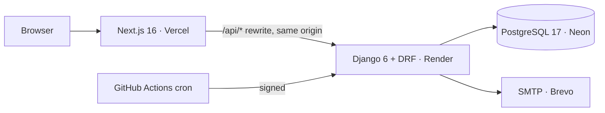

# Cadence

**Recurring revenue, kept in time.** Cadence is a subscription management system: products and plans, quotations, subscriptions, automated recurring invoices, taxes, discounts, payments, a customer portal and a finance dashboard, in one place.

Built for the **Odoo Hackathon** problem statement *Subscription Management System* ("Brightloop Software").

| | |
|---|---|
| Live app | https://cadence-brightloop.vercel.app |
| API docs | https://cadence-api-g6af.onrender.com/api/docs/ (OpenAPI / Swagger) |
| Demo video | _added at submission_ |

## Try it: demo logins
Open the [live app](https://cadence-brightloop.vercel.app/login), or use **Show demo logins** on the login page.

| Role | Email | Password | What you'll see |
|---|---|---|---|
| Admin | `demo.admin@brightloop.test` | `Cadence@Demo2026` | Everything: dashboard, pipeline, catalog, staff, billing preview |
| Staff | `demo.staff@brightloop.test` | `Cadence@Demo2026` | Day-to-day work, no settings or staff management |
| Customer | `asha@raotraders.test` | `Cadence@Demo2026` | Only Asha's own subscriptions and invoices |

These logins are **read-only by design**: the server refuses every change they attempt, password reset and account lockout don't apply to them, and they can't reach the Django admin. The billing preview still works because it rolls back. To try saving changes, create your own account. Your signup gets a normal customer login. The API may take up to a minute to wake on the free tier the first time.

## Why it exists
At Brightloop, subscriptions live in a spreadsheet, renewals depend on whoever remembers, invoices are typed by hand, payments are matched by scrolling bank statements, and nobody can say what the recurring revenue is. Cadence replaces each of those with a system that bills every subscription **exactly once, on time**, and shows the money picture live.

## What it does
- **Accounts and roles**: signup with a strict password policy, email reset links; admin / staff / customer roles; only admins add staff.
- **Catalog**: products (type, sales and cost price, notes), attribute-based variants (Brand = Odoo adds ₹560), taxes, payment terms.
- **Plans**: daily / weekly / monthly / yearly, minimum quantity, availability window, per-plan auto-close / close / pause / renew rules.
- **Quotations to subscriptions**: reusable quotation templates with a validity period; Draft → Quotation → Confirmed → Active → Closed (plus Paused), with a full timeline.
- **Billing engine**: invoices generated from subscriptions with lines, taxes and discounts; idempotent at the database level, catches up missed periods, runs on a schedule or on demand.
- **Discounts**: fixed or percentage, minimums, date window and usage limit, product- or subscription-scoped; applied automatically and stopped automatically.
- **Payments**: method, amount, date and note against an invoice; partial payments; paid / outstanding / overdue at a glance.
- **Finance dashboard**: active subscriptions, MRR/ARR, invoiced vs collected, outstanding and overdue, with filters.
- **Customer portal**: customers see and manage only their own subscriptions and invoices.

## Architecture

| Layer | Tech |
|---|---|
| Frontend | Next.js 16 (App Router), TypeScript, Tailwind CSS v4, shadcn/ui, TanStack Query/Table, react-hook-form + zod, Recharts |
| Landing | React Three Fiber, GSAP + ScrollTrigger, Lenis |
| Backend | Django 6, Django REST Framework, django-filter, drf-spectacular (OpenAPI) |
| Database | PostgreSQL 17 with CHECK constraints, partial unique and partial indexes |
| Auth | Django sessions + CSRF, Argon2 hashing |
| Ops | GitHub Actions (CI + billing scheduler), Docker Compose (local DB) |

More detail: [Architecture](docs/ARCHITECTURE.md) · [Data model](docs/DATA_MODEL.md) · [API](docs/API.md) · [Billing rules](docs/BILLING_RULES.md) · [Design system](docs/DESIGN.md) · [Deployment](docs/DEPLOYMENT.md) · [Roadmap](docs/ROADMAP.md) · [Demo](docs/DEMO.md)

### Database design highlights
- `UNIQUE (subscription_id, period_start) WHERE status <> 'cancelled'`: **a billing period can never be invoiced twice**, even by concurrent runs.
- `CHECK (total = subtotal - discount_total + tax_total)`, `CHECK (amount_paid <= total)`, `CHECK (status <> 'paid' OR amount_paid = total)`: money invariants enforced by Postgres.
- Price, name and tax-rate **snapshots** on subscription and invoice lines, so history never changes when the catalog does.
- Partial indexes for the two hottest queries: subscriptions due for billing and open invoices by due date.
- Discount usage and overdue status are **derived**, never stored, so they cannot drift.

## Quick start
```bash
docker compose up -d db
cd backend && python -m venv .venv && source .venv/bin/activate
pip install -r requirements-dev.txt && cp .env.example .env
python manage.py migrate && python manage.py seed_demo && python manage.py runserver
# new terminal
cd frontend && npm install && cp .env.example .env.local && npm run dev
```
Full instructions: [docs/DEPLOYMENT.md](docs/DEPLOYMENT.md).

## Performance
Measured in production on 31 Oct 2026 with 5,000 subscriptions and 18,032 invoices. Total is the time seen in the browser through Vercel to Render; the free tier's cold start is not included. Every app page also shows the last request's server time and query count in its footer.

| Request | Total | Server | Queries |
|---|---|---|---|
| Dashboard summary | 205 ms | 48 ms | 8 |
| Revenue, 12 months | 277 ms | 31 ms | 4 |
| Overdue aging | 164 ms | 19 ms | 3 |
| Pipeline | 309 ms | 28 ms | 4 |
| Subscriptions list | 204 ms | 75 ms | 11 |
| Subscription search | 379 ms | 92 ms | 11 |
| Invoices list | 207 ms | 48 ms | 4 |
| Overdue invoices | 182 ms | 21 ms | 4 |
| Payments list | 126 ms | 22 ms | 4 |
| Customer search | 205 ms | 21 ms | 4 |

## Team
| Member | Role |
|---|---|
| [@Harsha-code-per](https://github.com/Harsha-code-per) | Database design, backend foundation, landing page, deployment |
| [@loktrishal-05](https://github.com/loktrishal-05) | Design system, frontend shell, catalog |
| [@Sanjjith27](https://github.com/Sanjjith27) | Subscriptions, billing engine, invoices |
| [@Cholan-kinnera](https://github.com/Cholan-kinnera) | Auth and roles, payments, dashboard, customer portal, QA |

How we work: [Engineering standards (six pillars)](docs/ENGINEERING_STANDARDS.md) · [CONTRIBUTING.md](CONTRIBUTING.md) · [docs/TEAM_PLAN.md](docs/TEAM_PLAN.md) · Security: [SECURITY.md](SECURITY.md)

## License
[MIT](LICENSE)
