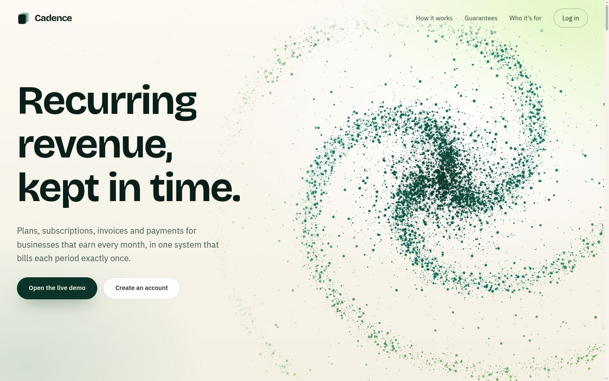
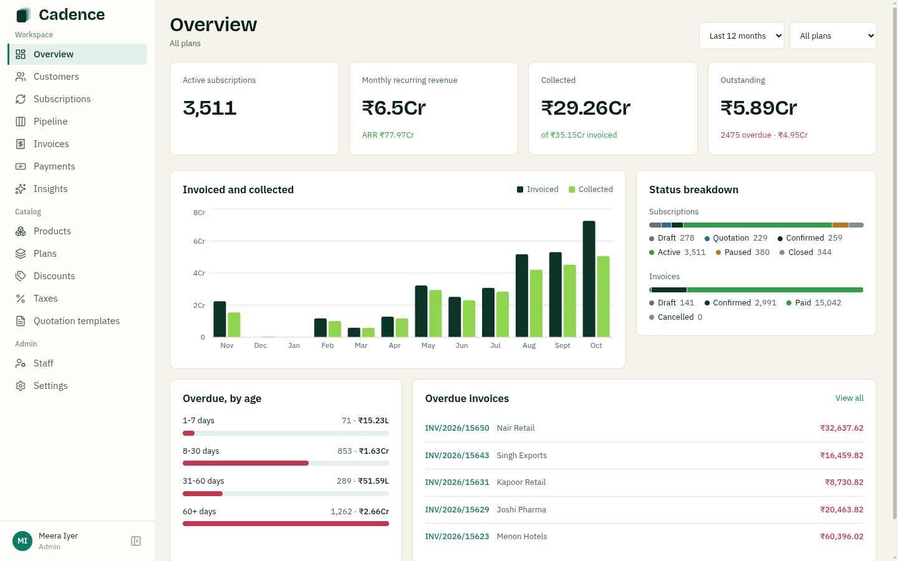
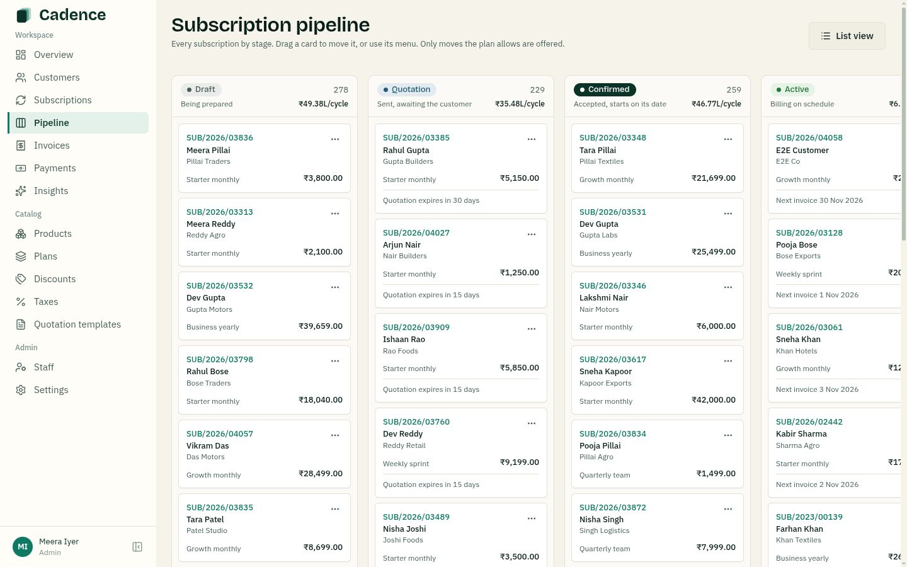
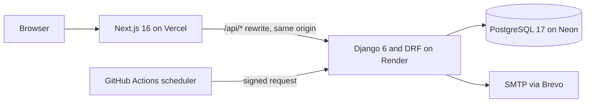

<div align="center">

# Cadence

**Recurring revenue, kept in time.**

The system of record for subscription businesses: plans, quotations, recurring invoices, taxes, discounts, payments and finance reporting in one place.

[](https://github.com/Harsha-code-per/Cadence/actions/workflows/backend.yml)
[](https://github.com/Harsha-code-per/Cadence/actions/workflows/frontend.yml)
[](LICENSE)

[Live app](https://cadence-brightloop.vercel.app) · [API reference](https://cadence-api-g6af.onrender.com/api/docs/) · [Architecture](docs/ARCHITECTURE.md) · [Data model](docs/DATA_MODEL.md)



</div>

## Overview

A subscription company bills every customer, every period. When that lives in spreadsheets, renewals are missed, invoices go out wrong and nobody can say how much recurring revenue the business really has.

Cadence runs the whole lifecycle from one PostgreSQL database. A quotation becomes a subscription, subscriptions bill themselves on schedule, discounts and taxes apply without anyone remembering them, and finance sees the real numbers at any moment. Its money rules are enforced by the database itself, so a bug or a double click can't bill a customer twice.

Built for the Odoo Hackathon problem statement *Subscription Management System* ("Brightloop Software").

## Try it

Sign in at the [live app](https://cadence-brightloop.vercel.app/login), or use **Show demo logins** on the login page.

| Role | Email | Password | Access |
|---|---|---|---|
| Admin | `demo.admin@brightloop.test` | `Cadence@Demo2026` | Everything: dashboard, pipeline, catalog, staff, billing preview |
| Staff | `demo.staff@brightloop.test` | `Cadence@Demo2026` | Day-to-day work, without staff management or catalog changes |
| Customer | `asha@raotraders.test` | `Cadence@Demo2026` | Only Asha's own subscriptions and invoices |

These logins are public, so the server makes them **read-only**: every change is refused, and they never see real people's contact details. To try the full write flow, [run Cadence locally](#getting-started).

The API runs on a free tier, so the first request after a quiet period can take a little longer.

## Product

| Finance dashboard | Subscription pipeline |
|---|---|
|  |  |

## Features

| Area | What it does |
|---|---|
| **Accounts and access** | Email signup with a strict password policy, reset links by email, and three roles. Only admins add staff, and customers see only their own records. |
| **Catalog** | Products with sales price, cost price and notes; attribute-based variants (Brand = Odoo adds ₹560); taxes and payment terms. |
| **Plans** | Daily, weekly, monthly or yearly billing, minimum quantity, availability dates, and per-plan rules for closing, pausing and renewing. |
| **Quotations and subscriptions** | Reusable quotation templates with a validity period, then Draft → Quotation → Confirmed → Active → Closed with a full activity timeline and a pipeline board. |
| **Recurring billing** | Invoices created from subscriptions with lines, taxes and totals. Runs on a schedule or on demand, catches up missed periods, and previews any date without saving. |
| **Discounts** | Fixed or percentage, with minimums, dates and usage limits, for products or whole subscriptions. Rules apply to the next invoice on their own and stop when they expire or run out. |
| **Payments** | UPI, card, bank transfer, cash or cheque, recorded against an invoice with partial payments and overpayment protection. |
| **Finance reporting** | MRR, ARR, collected, outstanding and overdue with filters, overdue aging, CSV export and rule-based churn insights. |
| **Customer portal** | Customers view their plans, invoices and receipts, accept quotations, and pause, resume, renew or cancel where the plan allows. |
| **Ask Cadence** *(optional)* | Plain-language finance questions answered from live aggregates. The AI picks from a fixed list of read-only reports, never writes SQL and never sees customer records. |

## Architecture



Cadence is a modular monolith. Each domain is a Django app with a one-way flow of `urls → views → services → models`, and all business rules live in the service layer. PostgreSQL holds the data with no backend-as-a-service in between.

| Layer | Technology |
|---|---|
| Frontend | Next.js 16 (App Router), TypeScript, Tailwind CSS v4, shadcn/ui, TanStack Query and Table, React Hook Form, Zod, Recharts |
| Landing page | React Three Fiber, GSAP, Lenis |
| Backend | Django 6, Django REST Framework, django-filter, drf-spectacular |
| Database | PostgreSQL 17 |
| Authentication | Django sessions with CSRF protection, Argon2 password hashing |
| Delivery | GitHub Actions for CI and the billing schedule, Docker Compose for the local database |

### Database design

The database is the last line of defence for money, so the important rules hold even if application code is wrong.

- **No double billing:** `UNIQUE (subscription_id, period_start) WHERE status <> 'cancelled'` means a period can't be invoiced twice, even by simultaneous runs.
- **Invoices always add up:** `CHECK (total = subtotal - discount_total + tax_total)`, and each line is checked the same way.
- **Paid means paid:** `CHECK (amount_paid <= total)` and `CHECK (status <> 'paid' OR amount_paid = total)`.
- **History never changes:** invoice lines store a snapshot of names, prices and taxes, so editing the catalog can't rewrite a past bill.
- **Fast at scale:** partial indexes cover the due-subscriptions and open-invoices queries that run most often.
- **Safe under concurrency:** row locks with `SKIP LOCKED` let billing runs overlap safely. Real parallel-transaction tests prove it.

Every table, constraint and index is documented in the [data model](docs/DATA_MODEL.md).

### Security

- Session cookies with CSRF protection, Argon2 hashing, and account lockout after repeated failed logins
- Every customer query scoped on the server: another customer's record returns 404
- One error format across the API, with no internal details exposed
- Security headers and a Content Security Policy on the frontend
- A single middleware makes public demo accounts read-only, including for endpoints added later

Report a vulnerability through [SECURITY.md](SECURITY.md).

## Performance

The brief asks for every page to respond in under two seconds with thousands of subscriptions.

Measured in production on 31 October 2026 with 5,000 subscriptions and 18,032 invoices. Total is the time seen in the browser; a free-tier cold start is not included. Every app page shows the server time and query count of its last request in the footer.

| Request | Total | Server | Queries |
|---|---|---|---|
| Dashboard summary | 205 ms | 48 ms | 8 |
| Revenue, 12 months | 277 ms | 31 ms | 4 |
| Overdue aging | 164 ms | 19 ms | 3 |
| Pipeline | 309 ms | 28 ms | 4 |
| Churn insights | 268 ms | 74 ms | 3 |
| Subscriptions list | 204 ms | 75 ms | 11 |
| Subscription search | 379 ms | 92 ms | 11 |
| Invoices list | 207 ms | 48 ms | 4 |
| Overdue invoices | 182 ms | 21 ms | 4 |
| Payments list | 126 ms | 22 ms | 4 |
| Customer search | 205 ms | 21 ms | 4 |

## Quality

- **230+ automated backend tests** on PostgreSQL, covering billing, concurrency, permissions and the database constraints
- CI runs ruff and pytest for the backend, and ESLint, TypeScript and a production build for the frontend
- API types generated from the OpenAPI schema, so the frontend can't drift from the backend
- Keyboard navigation, reduced-motion support and layouts tested at phone width

See the [engineering standards](docs/ENGINEERING_STANDARDS.md) and the [QA matrix](docs/DEMO.md).

## Getting started

**Requirements:** Python 3.13, Node.js 22 and Docker.

```bash
# Database
docker compose up -d db

# Backend, on http://localhost:8000
cd backend
python -m venv .venv && source .venv/bin/activate
pip install -r requirements-dev.txt
cp .env.example .env
python manage.py migrate
python manage.py seed_demo
python manage.py runserver

# Frontend, on http://localhost:3000, in a new terminal
cd frontend
npm install
cp .env.example .env.local
npm run dev
```

`seed_demo` creates a realistic dataset. Its local login details are explained in `backend/.env.example`.

```bash
# Backend checks
cd backend && pytest && ruff check . && ruff format --check .

# Frontend checks
cd frontend && npx next typegen && npx eslint src && npx tsc --noEmit
```

Production setup is covered in the [deployment guide](docs/DEPLOYMENT.md).

## Project structure

```text
backend/
  apps/
    accounts/        users, roles, customers
    catalog/         products, variants, plans, taxes, discounts, templates
    subscriptions/   lifecycle and state machine
    billing/         invoice engine, scheduler endpoint, exports
    payments/        receipts against invoices
    analytics/       dashboard, aging, insights, portal summary
    assistant/       Ask Cadence
    core/            sequences, audit log, middleware, permissions
frontend/
  src/app/           routes for the app, portal, auth and print views
  src/components/    data tables, forms, dashboard, landing page
docs/                architecture, data model, API, billing rules, design
```

## Documentation

| Document | Covers |
|---|---|
| [Architecture](docs/ARCHITECTURE.md) | System design and module boundaries |
| [Data model](docs/DATA_MODEL.md) | Tables, constraints and indexes |
| [API](docs/API.md) | Endpoints and the error format |
| [Billing rules](docs/BILLING_RULES.md) | State machines, period maths, tax, discounts and rounding |
| [Design system](docs/DESIGN.md) | Colour, type and components |
| [Deployment](docs/DEPLOYMENT.md) | Environment and hosting |

## Team

| Member | Focus |
|---|---|
| [@Harsha-code-per](https://github.com/Harsha-code-per) | Database design, backend foundation, landing page, deployment |
| [@loktrishal-05](https://github.com/loktrishal-05) | Design system, frontend platform, catalog, Ask Cadence |
| [@Sanjjith27](https://github.com/Sanjjith27) | Subscriptions, billing engine, invoices, concurrency tests |
| [@Cholan-kinnera](https://github.com/Cholan-kinnera) | Accounts and roles, payments, dashboard, customer portal, QA |

Read [CONTRIBUTING.md](CONTRIBUTING.md) before opening a pull request.

## License

Released under the [MIT License](LICENSE).
