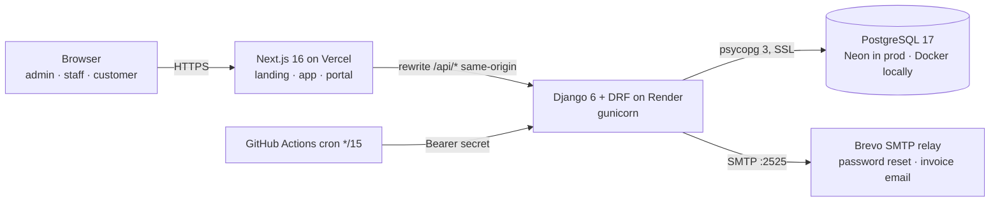

# Architecture

> Owner: **M1**. Read with [DATA_MODEL](DATA_MODEL.md), [API](API.md), [BILLING_RULES](BILLING_RULES.md), [DESIGN](DESIGN.md).

## 1. System



- **Modular monolith**: one Django project, one Django app per business domain. Simple to deploy and transactional across domains (an invoice and its payment allocation commit together).
- **Same-origin API**: Next rewrites `/api/:path*` to `API_URL`. Session cookies and CSRF work with no CORS config, and the Render URL is never exposed to the browser.
- **No BaaS**: Neon is only a PostgreSQL server reached through `DATABASE_URL`. Schema, migrations, auth, permissions and business logic are all ours. Swapping hosts is a one-line env change.
- **Third-party surface**: SMTP and an optional OpenAI-compatible Ask Cadence endpoint (stdlib urllib). No payment SDK. The assistant selects one allowlisted analytics aggregate and phrases its numbers; no SQL generation or customer rows leave the app. It is disabled unless configured.

## 2. Repository layout

```
Cadence/
├── backend/
│   ├── config/                 settings.py (env-driven), urls.py, wsgi.py
│   ├── apps/
│   │   ├── core/               base models, Sequence, AuditLog, permissions, pagination, exceptions, health, public stats
│   │   ├── accounts/           User, Customer, auth views, password validator, staff
│   │   ├── catalog/            Product, Attribute(Value), Variant, Tax, PaymentTerm, Plan, Discount, QuotationTemplate
│   │   ├── subscriptions/      Subscription, Line, Event, state.py
│   │   ├── billing/            Invoice, Line, LineTax, DiscountRedemption, pricing.py, services.py
│   │   ├── payments/           Payment, services.py
│   │   └── analytics/          no models: services.py (SQL aggregates), insights.py
│   ├── tests/                  pytest (per app: tests/test_<app>_*.py)
│   ├── requirements.txt / requirements-dev.txt / pyproject.toml (ruff, pytest)
│   └── manage.py
├── frontend/
│   └── src/
│       ├── app/
│       │   ├── page.tsx                    landing (M1)
│       │   ├── (auth)/login|signup|forgot-password|reset-password/[uid]/[token]   (M4)
│       │   ├── (app)/dashboard|customers|staff|payments|insights                    (M4)
│       │   ├── (app)/products|plans|taxes|discounts|quotation-templates|settings     (M2)
│       │   ├── (app)/subscriptions|invoices                                          (M3)
│       │   └── (portal)/portal/…                                                     (M4)
│       ├── components/ui/          shadcn primitives (M2)
│       ├── components/layout/      AppShell, Sidebar, PageHeader (M2)
│       ├── components/data/        DataTable, FilterBar, StatusBadge, Money, EmptyState (M2)
│       ├── components/landing/     (M1)
│       ├── lib/api.ts              fetch wrapper: CSRF, error shape → ApiError (M2)
│       ├── lib/api-types.ts        GENERATED from OpenAPI, never edit (M2 runs gen)
│       └── proxy.ts                role-based route guard (M4)
├── docs/  .github/  docker-compose.yml  render.yaml
```

## 3. Backend layers (every app follows this)

```
urls.py → views.py (DRF ViewSet: auth, permissions, queryset scoping, (de)serialize)
        → services.py (business rules, transactions, raises DomainError)
        → models.py (fields, constraints, indexes; no business workflows)
```
- **Views stay thin**: validate with a serializer, call a service, return a serializer. No money math in views or serializers.
- **Services** are plain functions with explicit args (`confirm_subscription(sub, actor)`), wrapped in `transaction.atomic()`, raising `core.exceptions.DomainError(code, message, field_errors=None)`. The global exception handler maps these to the error shape in API.md.
- **Queryset scoping** for customers lives in one mixin, `core.permissions.CustomerScopedMixin`, which filters on `customer__user=request.user` when the role is customer. Every customer-facing viewset uses it. That's how BOLA is prevented.
- **Permissions** (`core.permissions`): `IsAdmin`, `IsAdminOrStaff`, `IsAdminOrReadOnlyStaff` (catalog), `ReadOnlyForCustomer`.
- **N+1 prevention**: every list `get_queryset()` uses `select_related`/`prefetch_related`; key list endpoints have an `assertNumQueries` test.
- **Audit**: `core.audit.record(actor, action, obj, changes)` is called from services, never from views.

## 4. Frontend architecture
- **App Router** with route groups: `(auth)`, `(app)` (staff/admin shell with sidebar), `(portal)` (customer shell), and the landing at `/`.
- **Data**: TanStack Query for every server call (`useQuery` keyed by `[resource, filters]`; mutations invalidate). Server-side pagination, filtering and sorting only; tables never hold more than one page.
- **Tables**: one shared `DataTable` (TanStack Table) with URL-synced filters (`?status=active&page=2`), so views are shareable and survive refreshes.
- **Forms**: react-hook-form + zod mirroring the backend rules (password policy, positive amounts, date ranges). Server `field_errors` map back onto fields. Toasts via sonner. The button label matches the toast ("Confirm invoice" → "Invoice confirmed").
- **State and money**: the UI never computes totals that matter. It shows `amount`, `total` and `outstanding` from the API. Line previews in forms are labelled "estimate".
- **Guards**: `proxy.ts` reads `/api/auth/me/` via the session cookie: unauthenticated → `/login`; customer → `/portal`; staff hitting admin-only routes → `/dashboard`. The backend still enforces everything.
- **Performance**: route-level code splitting; the landing's three.js/GSAP bundle loads only on `/`; debounced search (300 ms); skeletons instead of spinners.

## 5. Security
See [SECURITY.md](../SECURITY.md) for the full list. Highlights:
- Argon2 password hashing; custom policy validator; login/signup/reset throttled (`ScopedRateThrottle`).
- Session cookie httpOnly + Secure + SameSite=Lax; CSRF on unsafe methods; `SECURE_PROXY_SSL_HEADER` behind Render.
- Object-level scoping for customers (404, not 403, outside scope). Role checks on every write.
- Password reset: Django `PasswordResetTokenGenerator` (single use, expires in 1 h, invalidated by a password change); always returns 204.
- Scheduler endpoint: bearer secret compared with `hmac.compare_digest`; bounded batch.
- Secrets only in env vars; `.env` is gitignored; `DEBUG=False` in prod; strict `ALLOWED_HOSTS`/`CSRF_TRUSTED_ORIGINS`.

## 6. Performance (brief: < 2 s with thousands of subscriptions)
- Indexes per hot query (DATA_MODEL): partial "due" and "open invoice" indexes, composite customer/date indexes.
- Aggregates in SQL (`Sum`/`Count` with `filter=`), never Python loops; the dashboard is one round-trip per widget.
- Page size 20 (max 100); `count` on filtered, indexed querysets.
- `seed_demo --subscriptions 5000` creates realistic volume (bulk_create); timings are measured with `curl -w %{time_total}` and recorded in the README.
- Render cold start is mitigated by the scheduler cron hitting the API every 15 min.
