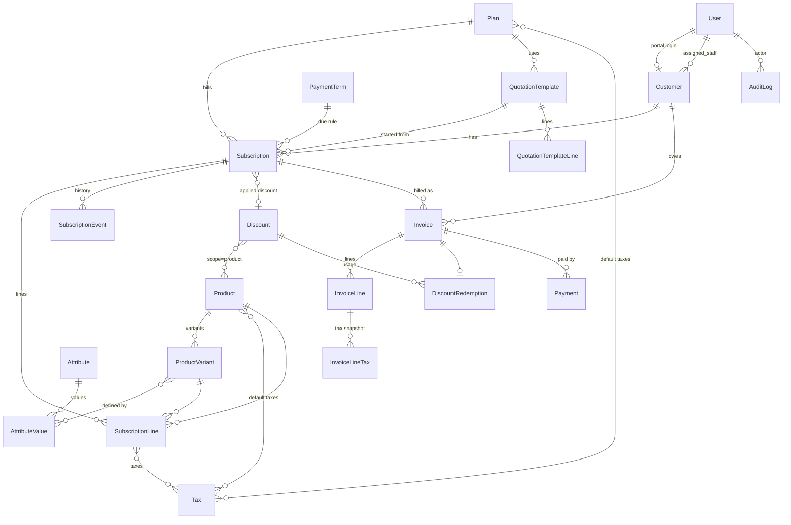

# Data Model

> Owner: **M1**. Source of truth for every table, constraint and index.
> Models live in the Django app named in each section. **M1 writes all models and the initial migrations in hour 1.** After that, only the app owner adds migrations to their app ([TEAM_PLAN](TEAM_PLAN.md)).
> Business rules that use these tables: [BILLING_RULES](BILLING_RULES.md).

## Conventions
- Primary keys: `BigAutoField` (`id bigint`). Human-facing identifiers (`SUB/2026/00001`, `INV/2026/00001`) are separate unique columns produced by `core.Sequence`.
- Money: `NUMERIC(12,2)` (`DecimalField(max_digits=12, decimal_places=2)`). Tax rates: `NUMERIC(5,2)`. **Never float.** Single currency: INR.
- Timestamps: `created_at`, `updated_at` as `timestamptz` (from `core.TimeStampedModel`). Business dates (`start_date`, `due_date`) are `date`.
- Enums: `TextChoices` stored as `varchar` with a DB `CHECK (col IN (...))` generated from the choices.
- Financial foreign keys use `on_delete=PROTECT`. Child lines use `CASCADE` to their header.
- Table names: Django default `<app>_<model>` (e.g. `billing_invoice`).
- Derived values are not stored: **overdue** = `status='confirmed' AND due_date < today`; **MRR** is computed (see BILLING_RULES §6).

## ERD



---

## core (M1)

### `core_sequence`
Gapless, per-year document numbering. Read with `select_for_update()` inside the same transaction that creates the document.

| column | type | notes |
|---|---|---|
| id | bigint PK | |
| code | varchar(30) | `subscription`, `invoice`, `payment` |
| year | smallint | |
| prefix | varchar(10) | `SUB`, `INV`, `PAY` |
| next_value | integer | `CHECK (next_value > 0)` |

Constraints: `UNIQUE (code, year)`. Format: `f"{prefix}/{year}/{n:05d}"`.

### `core_auditlog`
| column | type | notes |
|---|---|---|
| id | bigint PK | |
| actor_id | FK → accounts_user, `SET_NULL`, null | null = system (scheduler) |
| action | varchar(60) | e.g. `subscription.confirm`, `invoice.cancel`, `payment.create`, `discount.create`, `staff.create` |
| entity_type | varchar(60) | model label |
| entity_id | bigint | |
| changes | jsonb | `{field: [old, new]}` or free payload |
| created_at | timestamptz | |

Index: `(entity_type, entity_id, created_at DESC)`.

---

## accounts (models M1, logic M4)

### `accounts_user` (custom `AUTH_USER_MODEL`, email login)
| column | type | notes |
|---|---|---|
| id | bigint PK | |
| email | varchar(254) | **`UNIQUE (LOWER(email))`** (functional unique constraint: one account per email, case-insensitive) |
| full_name | varchar(150) | |
| role | varchar(10) | `admin` · `staff` · `customer`, CHECK |
| password | varchar(128) | Argon2 hash |
| is_active | bool | |
| is_staff | bool | Django admin site access only (admins) |
| last_login, date_joined | timestamptz | |

`USERNAME_FIELD = "email"`. Password policy (custom validator): **length > 8, ≥1 uppercase, ≥1 lowercase, ≥1 special character**.

### `accounts_customer`
| column | type | notes |
|---|---|---|
| id | bigint PK | |
| user_id | FK → user, **unique**, null, `SET_NULL` | portal login; null for offline customers created by staff |
| name | varchar(150) | contact person |
| company | varchar(200) | blank ok |
| email | varchar(254) | `UNIQUE (LOWER(email))` |
| phone | varchar(30) | blank ok |
| address | text | billing address, blank ok |
| assigned_staff_id | FK → user, null, `SET_NULL` | |
| created_at, updated_at | timestamptz | |

Index: `(LOWER(name))` for search; `(assigned_staff_id)`.

---

## catalog (models M1, logic M2)

### `catalog_tax`
| column | type | notes |
|---|---|---|
| name | varchar(60) | `GST 18%` |
| rate | numeric(5,2) | `CHECK (rate >= 0 AND rate <= 100)` (percent of the line amount after discount) |
| is_active | bool | |

`UNIQUE (name)`.

### `catalog_paymentterm`
| name | varchar(60) unique | `Immediate`, `Net 15`, `Net 30` |
|---|---|---|
| due_days | smallint | `CHECK (due_days >= 0)` |

### `catalog_product`
| column | type | notes |
|---|---|---|
| name | varchar(150) | |
| product_type | varchar(10) | `service` · `goods` · `addon`, CHECK |
| sales_price | numeric(12,2) | `CHECK (sales_price >= 0)` |
| cost_price | numeric(12,2) | `CHECK (cost_price >= 0)` |
| notes | text | blank ok |
| is_active | bool | archive instead of delete |
| taxes | M2M → tax | default taxes copied onto subscription lines |

Index: `(LOWER(name))`.

### `catalog_attribute` / `catalog_attributevalue`
| attribute.name | varchar(60) unique | `Brand`, `Edition` |
|---|---|---|
| value.attribute_id | FK → attribute, CASCADE | |
| value.name | varchar(60) | `Odoo` |
| value.extra_price | numeric(12,2) | `CHECK (extra_price >= 0)`. **Brand=Odoo → 560** |

`UNIQUE (attribute_id, name)`.

### `catalog_productvariant`
| column | type | notes |
|---|---|---|
| product_id | FK → product, CASCADE | |
| values | M2M → attributevalue | |
| sku | varchar(60), unique, null | |
| is_active | bool | |

Variant price (computed, not stored) = `product.sales_price + Σ values.extra_price`.

### `catalog_plan`
| column | type | notes |
|---|---|---|
| name | varchar(150) | |
| price | numeric(12,2) | recurring plan fee per period, `CHECK (price >= 0)`; 0 = products only |
| billing_period | varchar(10) | `daily` · `weekly` · `monthly` · `yearly`, CHECK |
| interval_count | smallint | `CHECK (interval_count >= 1)` (every N periods) |
| min_quantity | integer | `CHECK (min_quantity >= 1)` |
| start_date | date | available from |
| end_date | date, null | available until; `CHECK (end_date IS NULL OR end_date >= start_date)` |
| auto_close | bool | close automatically at subscription expiry |
| closable | bool | can be closed early |
| pausable | bool | |
| renewable | bool | |
| is_active | bool | |
| taxes | M2M → tax | taxes on the plan-fee line |

### `catalog_discount` (admin only)
| column | type | notes |
|---|---|---|
| name | varchar(100) | |
| code | varchar(40), unique, null | optional coupon code |
| discount_type | varchar(10) | `percent` · `fixed`, CHECK |
| value | numeric(12,2) | `CHECK (value > 0)`; plus `CHECK (discount_type <> 'percent' OR value <= 100)` |
| scope | varchar(15) | `subscription` · `product`, CHECK |
| products | M2M → product | used when `scope='product'` |
| min_amount | numeric(12,2) | `CHECK (min_amount >= 0)`, default 0 |
| min_quantity | integer | `CHECK (min_quantity >= 0)`, default 0 |
| start_date | date | |
| end_date | date, null | `CHECK (end_date IS NULL OR end_date >= start_date)` |
| usage_limit | integer, null | `CHECK (usage_limit IS NULL OR usage_limit > 0)`; null = unlimited |
| is_active | bool | |

Usage count is **not stored**. It is `COUNT(discount_redemption)`, so it can never drift.

### `catalog_quotationtemplate` / `catalog_quotationtemplateline`
| template.name | varchar(150) | |
|---|---|---|
| template.validity_days | smallint | `CHECK (validity_days >= 1)` |
| template.plan_id | FK → plan, PROTECT | |
| template.payment_term_id | FK → paymentterm, PROTECT, null | |
| template.notes | text | |
| line.template_id | FK, CASCADE | |
| line.product_id | FK → product, PROTECT | |
| line.variant_id | FK → productvariant, PROTECT, null | |
| line.quantity | integer | `CHECK (quantity >= 1)` |
| line.description | varchar(255) | blank ok |

---

## subscriptions (models M1, logic M3)

### `subscriptions_subscription`
| column | type | notes |
|---|---|---|
| number | varchar(30) unique | `SUB/2026/00001` |
| customer_id | FK → customer, PROTECT | |
| plan_id | FK → plan, PROTECT | |
| status | varchar(10) | `draft` · `quotation` · `confirmed` · `active` · `paused` · `closed`, CHECK |
| start_date | date | |
| expiration_date | date, null | `CHECK (expiration_date IS NULL OR expiration_date >= start_date)` |
| next_invoice_date | date, null | set on activation, advanced by the billing engine |
| payment_term_id | FK → paymentterm, PROTECT | |
| quotation_template_id | FK, null, SET_NULL | |
| valid_until | date, null | quotation expiry = sent date + template.validity_days |
| discount_id | FK → discount, null, PROTECT | subscription-level discount chosen by staff |
| salesperson_id | FK → user, null, SET_NULL | |
| renewed_from_id | FK → self, null, SET_NULL | renewal chain |
| close_reason | varchar(255) | blank ok |
| notes | text | |
| created_at, updated_at | timestamptz | |

Indexes:
- `idx_sub_due`: `(next_invoice_date) WHERE status = 'active'` (partial; the billing engine's only scan)
- `(status)`, `(customer_id, created_at DESC)`, `(plan_id)`

### `subscriptions_subscriptionline`
| subscription_id | FK, CASCADE | |
|---|---|---|
| product_id | FK → product, PROTECT | |
| variant_id | FK → variant, PROTECT, null | |
| description | varchar(255) | |
| quantity | integer | `CHECK (quantity >= 1)` |
| unit_price | numeric(12,2) | **snapshot** at creation (variant price); later catalog edits don't change contracts. `CHECK (unit_price >= 0)` |
| taxes | M2M → tax | copied from product defaults, editable |

### `subscriptions_subscriptionevent`
| subscription_id | FK, CASCADE | |
|---|---|---|
| from_status | varchar(10) | blank for creation |
| to_status | varchar(10) | |
| actor_id | FK → user, null, SET_NULL | null = system |
| note | varchar(255) | |
| created_at | timestamptz | |

Index: `(subscription_id, created_at)`.

---

## billing (models M1, logic M3)

### `billing_invoice`
| column | type | notes |
|---|---|---|
| number | varchar(30) unique | `INV/2026/00001` |
| subscription_id | FK, PROTECT | |
| customer_id | FK, PROTECT | denormalized for fast portal/customer queries |
| status | varchar(10) | `draft` · `confirmed` · `paid` · `cancelled`, CHECK |
| invoice_date | date | |
| due_date | date | `CHECK (due_date >= invoice_date)` |
| period_start | date | |
| period_end | date | `CHECK (period_end >= period_start)` |
| subtotal | numeric(12,2) | Σ line amount before discount |
| discount_total | numeric(12,2) | `CHECK (discount_total >= 0)` |
| tax_total | numeric(12,2) | `CHECK (tax_total >= 0)` |
| total | numeric(12,2) | `CHECK (total >= 0)`; `CHECK (total = subtotal - discount_total + tax_total)` |
| amount_paid | numeric(12,2) | `CHECK (amount_paid >= 0 AND amount_paid <= total)` (maintained by the payment service under row lock) |
| sent_at | timestamptz, null | |
| created_at, updated_at | timestamptz | |

Constraints and indexes:
- **`uq_invoice_period`: `UNIQUE (subscription_id, period_start) WHERE status <> 'cancelled'`** (partial unique: a period can never be billed twice, even by concurrent runs).
- `CHECK (status <> 'paid' OR amount_paid = total)`.
- `idx_inv_open_due`: `(due_date) WHERE status = 'confirmed'` (overdue / outstanding).
- `(customer_id, invoice_date DESC)`, `(status, invoice_date)`.

### `billing_invoiceline`
| invoice_id | FK, CASCADE | |
|---|---|---|
| product_id | FK → product, PROTECT, null | null for the plan-fee line |
| description | varchar(255) | name snapshot |
| quantity | integer | `CHECK (quantity >= 1)` |
| unit_price | numeric(12,2) | |
| amount | numeric(12,2) | `quantity × unit_price` |
| discount_amount | numeric(12,2) | `CHECK (discount_amount >= 0 AND discount_amount <= amount)` |
| tax_amount | numeric(12,2) | |
| total | numeric(12,2) | `amount - discount_amount + tax_amount` |

### `billing_invoicelinetax`
Snapshot so historic invoices never change when a tax rate is edited.
| line_id | FK, CASCADE | |
|---|---|---|
| tax_id | FK → tax, SET_NULL, null | |
| name | varchar(60) | |
| rate | numeric(5,2) | |
| amount | numeric(12,2) | |

### `billing_discountredemption`
| discount_id | FK → discount, PROTECT | |
|---|---|---|
| invoice_id | FK → invoice, CASCADE | |
| amount | numeric(12,2) | |
| created_at | timestamptz | |

`UNIQUE (discount_id, invoice_id)`. Cancelling an invoice deletes its redemptions, which frees the usage.

### `billing_billingrun`
One row per billing batch (powers "last run" on the Invoices page).
| run_date | date | |
|---|---|---|
| triggered_by | varchar(20) | `manual` · `scheduler` · `command` |
| activated, closed, invoiced, skipped | integer | counts |
| created_at | timestamptz | |

---

## payments (models M1, logic M4)

### `payments_payment`
| column | type | notes |
|---|---|---|
| number | varchar(30) unique | `PAY/2026/00001` |
| invoice_id | FK → invoice, PROTECT | |
| method | varchar(15) | `cash` · `bank_transfer` · `card` · `upi` · `cheque`, CHECK |
| amount | numeric(12,2) | `CHECK (amount > 0)` |
| payment_date | date | |
| reference | varchar(100) | blank ok (UTR / cheque no.) |
| note | text | blank ok |
| recorded_by_id | FK → user, SET_NULL, null | |
| created_at | timestamptz | |

Indexes: `(invoice_id)`, `(payment_date)`.

---

## Why this design (talking points)
1. **Correctness lives in the database, not just in Python**: CHECKs on every amount and date range; `total = subtotal - discount + tax`; `amount_paid ≤ total`; `paid ⇒ amount_paid = total`.
2. **Idempotent billing**: the partial unique index on `(subscription_id, period_start)` makes double billing impossible, even if two schedulers race.
3. **History is immutable**: subscription line prices, invoice line names and tax rates are snapshots.
4. **No drifting counters**: discount usage = `COUNT(redemptions)`; overdue = derived from `due_date`.
5. **Hot paths are indexed for the exact query**: partial indexes for "due today" and "open invoices"; composite `(customer_id, date DESC)` for portal lists.
6. **Gapless numbering** with row-locked sequences, which matches accounting expectations.

## Query plans

Measured on PostgreSQL 17 in the GitHub Actions service on 31 October 2026,
after `seed_demo --subscriptions 5000` and `ANALYZE`: 5,000 subscriptions and
18,032 invoices. These are single `EXPLAIN (ANALYZE, BUFFERS)` execution times,
not HTTP timings; results vary with data distribution and cache state.

| Query | Observed plan | Execution time |
|---|---|---:|
| Billing runner: due, activate or expire, ordered by id, `LIMIT 500 FOR UPDATE OF` subscription `SKIP LOCKED` | Sequential scan on subscriptions and the five-row plan table | 0.978 ms |
| Active due subscriptions, including the expiration guard | Bitmap index scan on `idx_sub_due` | 0.177 ms |
| Confirmed invoices with `due_date < 2026-10-31` | Bitmap index scan on `idx_inv_status_date`, then a due-date filter | 2.515 ms |
| Subscription search for `SUB/2026/00001` (number, customer name or company contains), limit 20 | Sequential scans on subscriptions and customers | 4.081 ms |

The subscription search measurement models its search predicate and limit; it
does not include every selected relation or the pagination count. Its `OR`
spans two tables, so an index on subscription number alone does not establish
that the combined search can use it. Search indexing and the runner's combined
predicate need further measurement on a larger dataset before claiming they use
an index. These figures do not establish the API's two-second target.

To reproduce the individual filter measurements on a disposable seeded PostgreSQL
database, run `ANALYZE` first and use the same date and search term:

```sql
EXPLAIN (ANALYZE, BUFFERS)
SELECT * FROM subscriptions_subscription
WHERE status = 'active' AND next_invoice_date <= DATE '2026-10-31'
  AND (expiration_date IS NULL OR next_invoice_date <= expiration_date);

EXPLAIN (ANALYZE, BUFFERS)
SELECT * FROM billing_invoice
WHERE status = 'confirmed' AND due_date < DATE '2026-10-31';

EXPLAIN (ANALYZE, BUFFERS)
SELECT s.* FROM subscriptions_subscription s
JOIN accounts_customer c ON c.id = s.customer_id
WHERE UPPER(s.number::text) LIKE '%SUB/2026/00001%'
   OR UPPER(c.name::text) LIKE '%SUB/2026/00001%'
   OR UPPER(c.company::text) LIKE '%SUB/2026/00001%'
ORDER BY s.created_at DESC, s.id DESC LIMIT 20;
```

The search uses a leading wildcard and an `OR` across subscription and customer
columns. The existing B-tree number index cannot serve the substring predicate,
and adding another ordinary index to subscriptions alone does not establish an
indexed plan for the whole search. A useful fix must preserve substring search
and be measured across both branches of that `OR`; it may also need a query
change and PostgreSQL-specific text indexing. That work is still pending.
